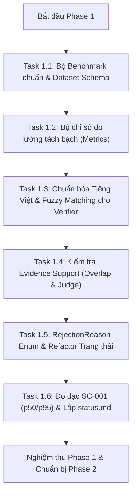

# Kế hoạch chi tiết thực thi Phase 1: Làm cho số liệu đáng tin

> **Mục tiêu**: Thay thế benchmark giả định bằng bộ dataset chuẩn có cấu trúc khoa học; tách bạch các chỉ số đo lường chất lượng; nâng cấp bộ thẩm định trích dẫn (Verifier) hỗ trợ tiếng Việt thực tế; bổ sung kiểm tra mức độ ủng hộ của bằng chứng (Evidence Support); chuyển đổi cơ chế xử lý lỗi từ chối sang dạng trạng thái có cấu trúc (`RejectionReason`); và xây dựng công cụ đo đạc số liệu độ trễ/chi phí thực tế.

---

## 1. Tóm tắt hiện trạng qua khảo sát thực tế (Codebase Audit)

1. **Benchmark hiện tại (`src/services/evaluation_runner.py`)**:
   - 25/30 câu hỏi trong `DEFAULT_BENCHMARK` là placeholder dạng `"Benchmark question N"`.
   - Không có đáp án chuẩn (`gold_answer`), không có danh sách trang chuẩn (`gold_pages`), không có trích dẫn chuẩn (`gold_evidence`).
   - Chỉ số `citation_accuracy` hiện chỉ đo "chuỗi evidence có xuất hiện trong trang hay không" mà không đo câu trả lời đúng hay sai, dẫn đến số liệu ảo 100%.
2. **Bộ chuẩn hóa của Verifier (`src/citation_verifier.py`)**:
   - Chỉ thực hiện `re.sub(r"\s+", " ", text).strip().lower()`.
   - Thất bại khi gặp: tiếng Việt tổ hợp (NFD), từ ngắt dòng bằng dấu gạch nối (`-\n`), ký tự ghép (ligatures như fi, fl), dấu ngoặc kép thông minh (“ ” ‘ ’ – —).
   - Chỉ kiểm tra so khớp nguyên văn (exact substring), không có so khớp mềm (fuzzy matching) khi PDF bị lỗi font nhẹ.
3. **Kiểm tra mức độ liên quan của bằng chứng (Evidence Support)**:
   - Hiện tại Verifier chỉ kiểm tra evidence có nằm trong trang trích dẫn hay không. Nếu LLM trích một câu bất kỳ trong trang không liên quan đến câu trả lời, Verifier vẫn xác nhận "Hợp lệ"!
4. **Cơ chế báo lỗi từ chối (`src/qa_service.py`)**:
   - Khi trích dẫn không hợp lệ, code hiện tại ném `ValueError("Unsupported citations were found...")` làm crash luồng xử lý và khó phân loại nguyên nhân nghiệp vụ.
5. **Đo đạc độ trễ và tiêu chí SC-001**:
   - Chưa có script đo đạc độ trễ đầu-cuối (p50/p95 latency) độc lập; tài liệu `docs/module-a/status.md` chưa được lập để theo dõi tiêu chuẩn đánh giá định lượng.

---

## 2. Kế hoạch chi tiết từng Task trong Phase 1 (Task 1.1 → 1.6)



---

### Task 1.1: Bộ benchmark thật có đáp án chuẩn

- **Các file tác động**:
  - `benchmarks/dataset.template.jsonl` (tạo mới - khung 30 câu chuẩn)
  - `benchmarks/dataset.jsonl` (tạo mới - dataset mẫu hoặc do người dùng điền)
  - `benchmarks/README.md` (tạo mới - hướng dẫn người dùng điền đáp án chuẩn)
  - `src/services/evaluation_runner.py` (sửa - đọc và validate dataset)
  - `tests/unit/test_dataset_schema.py` (tạo mới - kiểm thử nạp & kiểm tra schema)

- **Các bước thực hiện cụ thể**:
  1. **Định nghĩa Schema chuẩn (JSONL, mỗi dòng 1 JSON object)**:
     ```json
     {
       "id": "q001",
       "doc": "R. A. Elmasri, S. Navathe, Fundamentals of database systems-7th Edition.pdf",
       "question": "What is a database?",
       "gold_answer": "A database is a collection of related data.",
       "gold_pages": [4],
       "gold_evidence": "A database is a collection of related data.",
       "type": "factual", 
       "status": "needs_human_review"
     }
     ```
     - Phân loại `type`:
       - `factual`: Câu hỏi sự thật 1 trang (18 câu).
       - `multi-page`: Câu hỏi tổng hợp từ nhiều trang (6 câu).
       - `unanswerable`: Câu hỏi không có trong tài liệu nhằm đo lường khả năng từ chối đúng (6 câu).
  2. **Quy tắc Agent KHÔNG tự bịa đáp án**:
     - Tạo file mẫu `benchmarks/dataset.template.jsonl` với 30 câu hỏi khung.
     - Tạo `benchmarks/README.md` hướng dẫn chi tiết cách người dùng mở file PDF mẫu và điền `gold_answer`, `gold_pages`, `gold_evidence`, sau đó đổi `"status": "verified"`.
  3. **Nâng cấp `evaluation_runner.py`**:
     - Hàm `load_benchmark_dataset(path: str, allow_draft: bool = False) -> list[BenchmarkItem]`:
       - Kiểm tra tính đầy đủ của schema: bắt buộc có đủ các trường, `gold_pages` phải là list integer >= 1.
       - Nếu còn câu có `status == "needs_human_review"` hoặc chứa placeholder và `allow_draft == False` -> ném ngoại lệ `DatasetIncompleteError` nêu rõ các ID chưa hoàn tất.

- **Tiêu chí hoàn thành (DoD)**:
  - Thư mục `benchmarks/` chứa file template, README hướng dẫn và dataset schema chuẩn.
  - `load_benchmark_dataset` từ chối chạy khi dữ liệu chưa được người dùng review (trừ khi có cờ `allow_draft=True`).
  - Unit test kiểm tra schema hợp lệ/không hợp lệ pass 100%.

---

### Task 1.2: Bộ chỉ số đánh giá tách bạch (Multi-Dimensional Metrics)

- **Các file tác động**:
  - `src/services/metrics.py` (tạo mới - module tính toán chỉ số)
  - `src/services/evaluation_runner.py` (sửa - tích hợp xuất báo cáo JSON & Markdown)
  - `tests/unit/test_metrics_calculation.py` (tạo mới)

- **Các bước thực hiện cụ thể**:
  1. **Xây dựng module `src/services/metrics.py`** tính toán độc lập các chỉ số:
     | Chỉ số | Cách tính | Ý nghĩa |
     |---|---|---|
     | `page_hit_rate` | Tỷ lệ câu có trang trích dẫn ∩ `gold_pages` ≠ ∅ | Đo khả năng định vị đúng trang |
     | `evidence_verbatim_rate` | Tỷ lệ evidence xuất hiện nguyên văn trong trang trích dẫn | Đo độ trung thực trích dẫn nguồn |
     | `evidence_support_rate` | Tỷ lệ evidence thực sự hỗ trợ câu trả lời (Task 1.4) | Chống trích dẫn bừa bãi |
     | `answer_correctness` | Độ tương đồng giữa câu trả lời và `gold_answer` (tính qua F1 token overlap / cosine similarity, hoặc LLM Judge) | Đo tính chính xác nội dung |
     | `abstain_precision` | Với các câu `unanswerable`, tỷ lệ hệ thống từ chối trả lời đúng | Đo khả năng chống bịa đặt (hallucination) |
     | `fallback_rate` | Tỷ lệ câu rơi vào `local_fallback` | Tách riêng để không làm méo mó điểm của AI |
     | `latency_p50 / p95` | Thời gian xử lý ở phân vị 50 và 95 (ms) | Hiệu năng hệ thống |
     | `cost_total` | Tổng chi phí ước tính ($ USD) | Chi phí vận hành |
  2. **Cập nhật `run_evaluation` trong `evaluation_runner.py`**:
     - Hỗ trợ tham số so sánh: `compare_reference_material: bool = True` (chạy 2 lượt có và không có `reference_material` để đánh giá hiệu quả theo SC-003).
     - Xuất báo cáo kép:
       - File JSON: `benchmarks/reports/eval_report_<timestamp>.json` (phục vụ tự động hóa/CI).
       - File Markdown: `benchmarks/reports/eval_report_<timestamp>.md` (bảng đối chiếu trực quan cho con người đọc).

- **Tiêu chí hoàn thành (DoD)**:
  - Báo cáo xuất ra đầy đủ tất cả các chỉ số trên.
  - Tách riêng `fallback_rate`, không tính gộp câu fallback vào độ chính xác của AI.
  - Unit test với dữ liệu mẫu (mock evaluation results) cho ra kết quả tính toán chính xác 100% so với tính tay.

---

### Task 1.3: Nâng cấp chuẩn hóa text của verifier (Tiếng Việt & Fuzzy Matching)

- **Các file tác động**:
  - `src/text_normalize.py` (tạo mới)
  - `src/citation_verifier.py` (sửa - tích hợp chuẩn hóa mới)
  - `tests/unit/test_text_normalize.py` (tạo mới - >= 15 test cases)

- **Các bước thực hiện cụ thể**:
  1. **Xây dựng `src/text_normalize.py` với pipeline chuẩn hóa 6 bước**:
     - Bước 1: `unicodedata.normalize("NFC", text)` (chuyển toàn bộ tiếng Việt về dạng dựng sẵn chuẩn).
     - Bước 2: Chuẩn hóa ligatures (chữ ghép font PDF: `fi` -> `fi`, `fl` -> `fl`, `ff` -> `ff`, `ffi` -> `ffi`, `ffl` -> `ffl`) qua `unicodedata.normalize("NFKC", ...)` một cách an toàn không làm hỏng dấu tiếng Việt.
     - Bước 3: Nối từ bị ngắt dòng có dấu gạch nối cuối dòng: `re.sub(r"(\w+)-\s*\n\s*(\w+)", r"\1\2", text)`.
     - Bước 4: Chuẩn hóa dấu ngoặc kép, nháy, gạch ngang thông minh về ASCII: `“ ”` -> `"`, `‘ ’` -> `'`, `– —` -> `-`.
     - Bước 5: Gộp khoảng trắng liên tiếp và đưa về chữ thường (`lowercase`).
     - Bước 6: Hỗ trợ tùy chọn bỏ dấu câu khi cần so khớp ngữ nghĩa.
  2. **Bổ sung thuật toán So khớp mềm (Fuzzy Substring Matching)**:
     - Tính tỷ lệ Longest Common Substring (LCS) giữa `evidence_text` và đoạn văn bản trang tương ứng.
     - Phân loại kết quả so khớp `match_type`:
       - `"exact"`: Chuỗi evidence xuất hiện nguyên văn 100% trong trang sau normalize.
       - `"fuzzy"`: Tỷ lệ LCS trùng khớp đạt ngưỡng cấu hình (mặc định $\ge 90\%$).
       - `"none"`: Dưới ngưỡng hoặc không tìm thấy.
  3. **Cập nhật `citation_verifier.py`**:
     - Sử dụng pipeline chuẩn hóa mới cho cả `evidence_text` và `page.text`.

- **Tiêu chí hoàn thành (DoD)**:
  - Bộ test `test_text_normalize.py` gồm tối thiểu 15 test cases bao phủ: tiếng Việt NFC/NFD, dấu gạch nối ngắt dòng, ligatures, dấu ngoặc thông minh, khoảng trắng ngắt trang, fuzzy matching >= 90%.
  - 100% test cases đều pass.

---

### Task 1.4: Kiểm tra evidence có *ủng hộ* câu trả lời (Evidence Support Check)

- **Các file tác động**:
  - `src/services/support_check.py` (tạo mới)
  - `src/citation_verifier.py` (sửa - cấu trúc hóa kết quả thẩm định)
  - `tests/unit/test_support_check.py` (tạo mới)

- **Các bước thực hiện cụ thể**:
  1. **Mức 1: Heuristic Content Overlap (Mặc định - Rẻ, Nhanh, Không tốn token)**:
     - Lọc bỏ stopword tiếng Việt (như: *là, của, những, các, và, hoặc, thì, mà, ở, tại, trong, để, do, bởi, vì, có, được...*) và stopword tiếng Anh (*the, is, at, which, on, for, and, with...*).
     - Trích xuất tập hợp từ khóa nội dung (content words) của `answer.text` và `evidence_text`.
     - Tính tỷ lệ bao phủ từ khóa: Nếu tỷ lệ từ khóa cốt lõi của câu trả lời xuất hiện trong evidence dưới ngưỡng (mặc định 25%), đánh dấu cảnh báo `weak_support`.
  2. **Mức 2: LLM-Judge (Tùy chọn, bật qua biến `VERIFY_WITH_LLM=true`)**:
     - Dành cho các kiểm thử benchmark chuyên sâu.
     - Gửi prompt cố định yêu cầu LLM đánh giá logic: *"Dựa vào đoạn trích sau, câu trả lời có được ủng hộ về mặt ngữ nghĩa không? Trả về JSON {'supported': bool, 'reason': str}"*.
     - Cache kết quả LLM-Judge theo `sha256(answer + evidence)` để không bị gọi trùng lặp.
  3. **Chuyển đổi kết quả Verifier sang `VerificationResult`**:
     ```python
     @dataclass
     class CitationCheckResult:
         page_num: int
         match_type: Literal["exact", "fuzzy", "none"]
         supported: bool
         warnings: list[str]

     @dataclass
     class VerificationResult:
         valid: bool
         level: Literal["verified", "weak_support", "rejected"]
         per_citation: list[CitationCheckResult]
         warnings: list[str]
     ```
     - Cung cấp phương thức `__iter__` để hỗ trợ tương thích ngược dạng unpacking: `valid, warnings = result`.

- **Tiêu chí hoàn thành (DoD)**:
  - Test trường hợp: evidence nằm trong trang nhưng trích một câu không liên quan -> hệ thống phát hiện và gắn cờ `weak_support`.
  - Có cơ chế mock cho LLM-Judge khi chạy unit test.

---

### Task 1.5: Trạng thái & lý do trả về thay vì chỉ `raise ValueError`

- **Các file tác động**:
  - `src/models/answer.py` (sửa - bổ sung enum & trường mới)
  - `src/qa_service.py` (sửa - trả về rejected answer thay vì ném lỗi)
  - `src/streamlit_app.py` (sửa - hiển thị thông báo thân thiện theo mã lỗi)
  - `specs/001-document-qna-api/contracts/qa-api.md` (cập nhật contract)
  - `tests/unit/test_rejection_reasons.py` (tạo mới)

- **Các bước thực hiện cụ thể**:
  1. **Định nghĩa Enum `RejectionReason` trong `src/models/answer.py`**:
     - `NO_CITATION`: Mô hình không đưa ra bất kỳ trích dẫn trang nào.
     - `CITATION_NOT_FOUND`: Trích dẫn trỏ tới trang không tồn tại hoặc không tìm thấy bằng chứng trong trang.
     - `WEAK_SUPPORT`: Bằng chứng trích dẫn không đủ căn cứ để ủng hộ câu trả lời.
     - `EMPTY_PAGE`: Trang tài liệu được trỏ tới không có nội dung chữ đọc được.
     - `LLM_UNAVAILABLE`: Toàn bộ cascade model hoặc kết nối mạng bị gián đoạn.
     - `INVALID_INPUT`: Câu hỏi hoặc tài liệu rỗng / sai định dạng.
  2. **Cập nhật `Answer` dataclass**:
     - Thêm `rejection_reason: RejectionReason | None = None`.
     - Thêm `warnings: list[str] = field(default_factory=list)`.
     - Cập nhật `to_dict()` và `from_dict()` tương thích ngược.
  3. **Refactor `QAService.ask_question()`**:
     - Giữ `raise ValueError` cho lỗi đầu vào không hợp lệ (`question` rỗng).
     - Với lỗi nghiệp vụ thẩm định trích dẫn (insufficient / invalid citations): Trả về instance `Answer` với `status="rejected"`, gán `rejection_reason` tương ứng và danh sách `warnings` thay vì ném ngoại lệ.
  4. **Cập nhật giao diện Streamlit (`src/streamlit_app.py`)**:
     - Kiểm tra nếu `answer.status == "rejected"`:
       - Hiển thị thông báo tiếng Việt trực quan, nêu rõ nguyên nhân (ví dụ: *"Trích dẫn không khớp với tài liệu gốc"*, *"Bằng chứng không đủ chứng minh cho câu trả lời"*).
       - Hiển thị gợi ý hành động cụ thể để người dùng biết cách đặt lại câu hỏi hoặc kiểm tra tài liệu.
  5. **Cập nhật contract API**:
     - Bổ sung `rejection_reason` và `warnings` vào schema trong `specs/001-document-qna-api/contracts/qa-api.md`.

- **Tiêu chí hoàn thành (DoD)**:
  - `ask_question` không crash khi gặp trích dẫn không hợp lệ mà trả về đối tượng `Answer(status="rejected", ...)`.
  - UI hiển thị thông điệp riêng biệt cho từng lý do từ chối.
  - Contract API được cập nhật đồng bộ.

---

### Task 1.6: Đo thật SC-001 và ghi nhận tiêu chí còn thiếu

- **Các file tác động**:
  - `scripts/measure_latency.py` (tạo mới - script benchmark độ trễ)
  - `docs/module-a/status.md` (tạo mới - ma trận trạng thái FR/SC)
  - `src/config.py` (bổ sung cấu hình timeout & retry)
  - `tests/unit/test_latency_script.py` (tạo mới)

- **Các bước thực hiện cụ thể**:
  1. **Cấu hình Timeout & Retry**:
     - Bổ sung vào cấu hình: `LLM_TIMEOUT_SECONDS` (mặc định 60 giây, thay vì 15 giây quá ngắn gây rớt fallback oan).
     - Bổ sung cơ chế retry tối đa 2 lần với exponential backoff khi gặp lỗi mạng tạm thời trước khi chuyển model trong cascade.
  2. **Xây dựng script `scripts/measure_latency.py`**:
     - Nhận tham số `--api-key`, `--doc`, `--queries-file`, `--num-runs` (mặc định 20 câu).
     - Đo đạc thời gian xử lý end-to-end từng câu (bao gồm cả cache miss và cache hit).
     - Tính toán và in ra bảng thống kê: `Latency min, max, mean, p50, p95`.
     - Xuất file kết quả JSON: `benchmarks/reports/latency_<timestamp>.json`.
  3. **Tạo tài liệu `docs/module-a/status.md`**:
     - Thay thế tuyên bố chung chung "✅ Hoàn thành" bằng bảng ma trận kiểm soát chất lượng chính xác:
       - Trạng thái các yêu cầu chức năng (FR-001 → FR-009): `Implemented` / `Verified`.
       - Trạng thái các tiêu chí thành công (SC-001 → SC-005): `Measured` / `Met` / `Pending Data`.
       - Mỗi tiêu chí phải có số liệu đo đạc thực tế kèm ngày đo và đường dẫn file báo cáo benchmark đối chứng.

- **Tiêu chí hoàn thành (DoD)**:
  - Script `scripts/measure_latency.py` chạy độc lập và xuất đủ chỉ số p50/p95.
  - File `docs/module-a/status.md` được khởi tạo với bảng theo dõi minh bạch và các liên kết báo cáo.

---

## 3. Rà soát & Bịt kín các Lỗ hổng Logic tiềm ẩn trong Phase 1

1. **Rủi ro rò rỉ API key khi chạy benchmark**:
   - `evaluation_runner.py` và `measure_latency.py` phải nhận key qua tham số `--api-key` hoặc biến môi trường `GEMINI_API_KEY` ở tầng script, tuyệt đối không hardcode trong dataset hay file cấu hình.
2. **Không gọi API thật trong Unit Test**:
   - Mọi unit test cho `metrics.py`, `evaluation_runner.py`, `support_check.py` phải sử dụng dữ liệu giả lập (mocking) và `FakeLLMClient`. Việc gọi API thật chỉ diễn ra khi người dùng chủ động chạy script benchmark bằng lệnh tay.
3. **Tránh False Rejection với tiếng Việt có dấu**:
   - Nhờ pipeline `text_normalize.py`, các khác biệt về font chữ PDF (dấu gạch nối cuối dòng, ligatures, Unicode tổ hợp) sẽ không còn bị verifier từ chối oan uổng.

---

## 4. Kế hoạch kiểm thử & Lệnh chạy chuẩn Phase 1

```powershell
$env:PYTHONPATH = "src"
python -m pytest -q tests/
```

Mỗi task khi hoàn thành phải đảm bảo:
1. Viết unit test tương ứng cho task đó.
2. Đảm bảo toàn bộ test cũ và test mới đều pass (100% xanh).
3. Cập nhật nhật ký thay đổi [`CHANGELOG.md`](file:///c:/Users/AP/ai/docs/module-a/CHANGELOG.md) và [`verification-log.md`](file:///c:/Users/AP/ai/docs/module-a/verification-log.md).

---

## 5. Quyết định kỹ thuật cần người dùng xác nhận

1. **Ngưỡng Fuzzy Matching**: Bạn có đồng ý với ngưỡng Longest Common Substring $\ge 90\%$ cho so khớp mềm bằng chứng trong Task 1.3 không?
2. **Cơ chế Support Check**: Task 1.4 sử dụng Heuristic Keyword Overlap làm lớp kiểm tra mặc định (miễn phí, nhanh, không tốn token) và chỉ gọi LLM-Judge khi có cờ cấu hình. Bạn có đồng ý với cách tiếp cận này không?
3. **Phê duyệt triển khai**: Nếu bạn đồng ý với toàn bộ kế hoạch trên, vui lòng bấm **Proceed** hoặc phản hồi để tôi bắt đầu thực thi Task 1.1!
