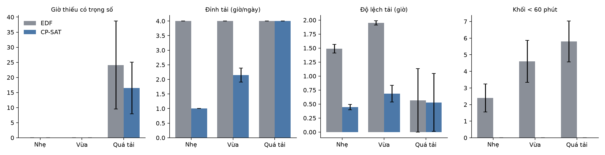
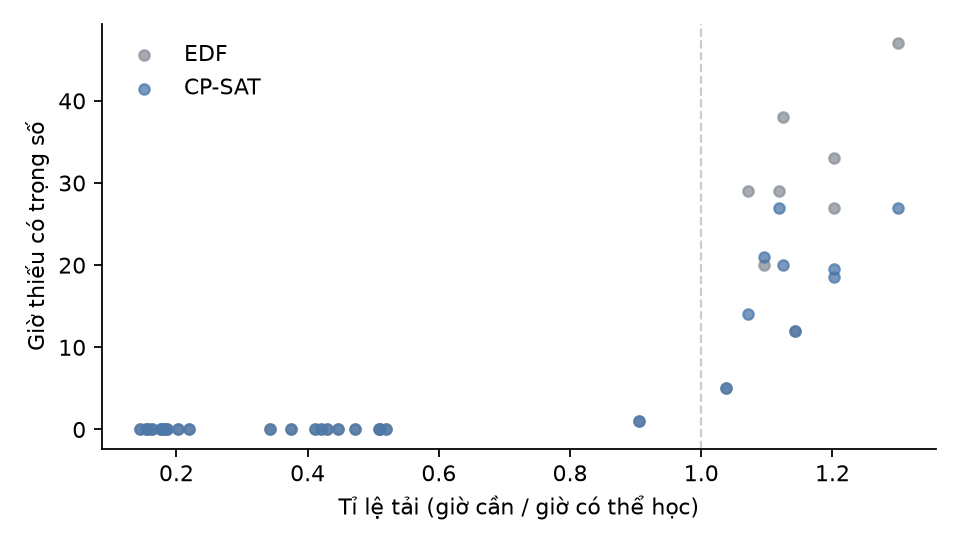

# SP2 — Phần C: Lập lịch học và nhắc nhở

*Người phụ trách: Long. Bản nháp do AI hỗ trợ soạn (xem nhật ký AI-002); số liệu lấy từ
`experiments/results/` và phải được người phụ trách đọc, kiểm chứng và viết lại bằng lời của mình
trước khi nộp.*

## C.1. Bài toán

Đầu vào là các nhiệm vụ sinh viên đã xác nhận (tên, hạn nộp, số giờ ước tính, độ ưu tiên) do
module B trích xuất, cùng thời khoá biểu hằng tuần. Đầu ra là các **khối tự học** cụ thể (ngày, giờ
bắt đầu, giờ kết thúc) và **nhắc nhở**.

Một lịch hợp lệ phải thoả các ràng buộc cứng:

1. Không trùng giờ lên lớp, không trùng nhau.
2. Nằm trong khung giờ học trong ngày (mặc định 7h–22h).
3. Kết thúc trước hạn nộp của nhiệm vụ.
4. Tổng giờ học mỗi ngày không vượt mức tối đa (mặc định 4 giờ).
5. Mỗi khối dài tối thiểu 60 phút (trừ nhiệm vụ cần ít hơn).

Khi tổng thời gian rảnh không đủ, hệ thống vẫn phải đưa ra lịch tốt nhất và ưu tiên việc quan trọng.
Ngoài ra, lịch nên **tải đều** giữa các ngày và **ít bị chia vụn**.

Đây là một bài toán **thoả mãn ràng buộc có tối ưu** (constrained optimization), một chủ đề trung
tâm của môn Trí tuệ nhân tạo (tìm kiếm trong không gian trạng thái có ràng buộc), khác với các
module dùng mô hình ngôn ngữ lớn.

**Nguyên tắc "AI chỉ đề xuất"**: chỉ nhiệm vụ đã được người dùng xác nhận mới được xếp lịch (hàm
`schedulable` trong `core/contracts.py`; giao diện có cột "Xác nhận").

## C.2. Phương pháp

### C.2.1. Rời rạc hoá thời gian

Chia thời gian thành ô 30 phút; giữ những ô nằm trong khung giờ học, không giao giờ lên lớp và chưa
trôi qua. 4 tuần ứng với khoảng 1 000 ô.

### C.2.2. Thuật toán cơ sở: Earliest Deadline First (EDF)

Sắp nhiệm vụ theo hạn nộp tăng dần (cùng hạn thì ưu tiên cao trước); mỗi nhiệm vụ lấy các ô rảnh
sớm nhất còn trống, trước hạn, chưa vượt giờ tối đa trong ngày.

Lý do chọn làm baseline: trên một "máy" không có ràng buộc phụ, sắp theo hạn sớm nhất tối thiểu hoá
độ trễ lớn nhất (quy tắc EDD, Jackson 1955) — một baseline mạnh và dễ giải thích.
*[Cần kiểm chứng: đọc và trích dẫn nguồn gốc, ví dụ giáo trình lập lịch của Pinedo.]*

Hạn chế dự kiến: dồn việc vào những ngày đầu, không cân nhắc độ ưu tiên khi quá tải, không quay lui.

### C.2.3. Thuật toán đề xuất: mô hình CP-SAT

Dùng bộ giải CP-SAT của Google OR-Tools.

Ký hiệu: `T` nhiệm vụ, `S` ô rảnh, `need_t` số ô cần, `A_t` các ô kết thúc trước hạn của `t`,
`w_t ∈ {1, 2, 3}` trọng số ưu tiên, `M` số ô tối đa/ngày, `k` độ dài khối tối thiểu (ô).

Biến:
- `x[t,s] ∈ {0,1}` (s ∈ A_t) — ô `s` dành cho `t`.
- `short_t ∈ [0, need_t]` — số ô thiếu.
- `load_d`, `peak` — tải theo ngày, tải lớn nhất.
- `y[t,s] ∈ {0,1}` — ô `s` mở đầu một khối mới của `t`.

Ràng buộc:
- `Σ_t x[t,s] ≤ 1` với mọi ô.
- `Σ_s x[t,s] + short_t = need_t` với mọi nhiệm vụ.
- `load_d = Σ x[t,s]` (s thuộc ngày d) `≤ M`; `peak = max_d load_d`.
- `y[t,s] ≥ x[t,s] − x[t,s−1]`.
- `y[t,s] ⇒ x[t,s+j]` với `j < min(k, need_t)`.

Mục tiêu theo thứ bậc:

```
min 10 000 · Σ w_t · short_t  +  100 · peak  +  Σ y[t,s]
```

tức là đủ giờ cho việc quan trọng ≫ tải đều ≫ ít khối.

Ba quyết định thiết kế rút ra từ chạy thử (chi tiết trong `specs/002-scheduler/research.md`):

1. **Khối tối thiểu.** Không có ràng buộc này, CP-SAT tải rất đều (1 giờ/ngày) nhưng cắt thành 37
   khối, phần lớn 30 phút — đúng toán học nhưng không dùng được thực tế. Thêm ràng buộc: còn 21
   khối, không khối nào < 60 phút.
2. **Điều kiện dừng.** Do nhiều lời giải đối xứng, solver tốn hết giới hạn thời gian để chứng minh
   số khối tối ưu. Cho dừng khi sai số < 100 (trọng số tải đỉnh): lúc đó giờ thiếu và tải đỉnh đã
   được chứng minh tối ưu.
3. **Khởi động ấm.** Với giới hạn 5–10 giây, ở kịch bản quá tải CP-SAT có lúc ra kết quả tệ hơn
   EDF và dao động giữa các lần chạy. Gợi ý lời giải EDF làm điểm xuất phát khắc phục được điều này.

### C.2.4. So sánh với các phương án khác

| Phương án | Ưu | Nhược | Quyết định |
|---|---|---|---|
| EDF tham lam | Rất nhanh, dễ giải thích | Không tối ưu khi có giới hạn giờ/ngày, ưu tiên | Baseline |
| CP-SAT | Bảo đảm ràng buộc cứng, tối ưu đa mục tiêu, chứng minh được tối ưu | Chậm hơn (giây), cần chỉnh trọng số | **Chọn** |
| Quy hoạch nguyên (PuLP/CBC) | Mô hình tương tự | Chậm hơn CP-SAT với biến nhị phân lớn, thêm phụ thuộc | Không chọn |
| Giải thuật di truyền | Linh hoạt | Không bảo đảm ràng buộc cứng, khó tái lập | Không chọn |
| Nhờ LLM xếp lịch | Hiểu ngôn ngữ tự nhiên | Không bảo đảm ràng buộc, khó kiểm chứng | Không chọn |

*[Cần kiểm chứng: nhận định "PuLP/CBC chậm hơn" mới là suy luận, chưa đo trong đồ án này — hoặc đo,
hoặc bỏ cột lý do này.]*

## C.3. Tích hợp vào hệ thống

- Vào: `Task` từ module B, chỉ những task có trạng thái `confirmed`.
- Ra: `StudyBlock` và `Reminder` (hợp đồng chung trong `core/contracts.py`).
- Nhắc nhở trước mỗi khối học (mặc định 30 phút) và trước hạn nộp (mặc định 24 giờ):
  - Xuất file iCalendar `.ics` để nhập vào Google Calendar hoặc lịch điện thoại.
  - Gửi qua Telegram Bot API, mỗi nhắc nhở đúng một lần (`python -m modules.scheduler.notify`
    chạy định kỳ).
- Giao diện: bảng xác nhận nhiệm vụ, tải thời khoá biểu CSV, cài đặt, bảng chỉ số hai thuật toán,
  lịch tuần.

## C.4. Thí nghiệm và kết quả

### C.4.1. Thiết kế

Tái lập bằng `python -m experiments.compare_schedulers` (hạt giống cố định; bảng đầy đủ ở
`experiments/results/summary.md`, từng lần chạy ở `runs.csv`).

- Dữ liệu **tổng hợp**: 3 kịch bản × 10 seed. Chưa có nhiệm vụ thật từ module B — xem C.5.
- Cài đặt chung: 28 ngày, thời khoá biểu mẫu 6 buổi/tuần, khung 7h–22h, tối đa 4 giờ/ngày,
  CP-SAT giới hạn 10 giây.
- **Tỉ lệ tải** = giờ cần làm / giờ có thể học trước hạn cuối (đã tính giới hạn mỗi ngày).

| Kịch bản | Số nhiệm vụ | Giờ mỗi việc | Hạn nộp (ngày thứ) | Tỉ lệ tải |
|---|---|---|---|---|
| Nhẹ | 6 | 2–4 | 7–27 | 0,18 ± 0,02 |
| Vừa | 12 | 2–6 | 5–27 | 0,44 ± 0,06 |
| Quá tải | 18 | 3–8 | 3–20 | 1,12 ± 0,11 |

Cả hai thuật toán chạy trên đúng cùng dữ liệu; chỉ số tính bằng cùng một hàm (`metrics.py`).

### C.4.2. Kết quả chính (trung bình ± độ lệch chuẩn, 10 seed)

| Chỉ số | Nhẹ: EDF | Nhẹ: CP-SAT | Vừa: EDF | Vừa: CP-SAT | Quá tải: EDF | Quá tải: CP-SAT |
|---|---|---|---|---|---|---|
| Xung đột ràng buộc | 0 | 0 | 0 | 0 | 0 | 0 |
| Giờ thiếu có trọng số | 0 | 0 | 0 | 0 | 24,1 ± 14,6 | **16,5 ± 8,6** |
| Giờ thiếu của việc ưu tiên cao | 0 | 0 | 0 | 0 | 2,7 ± 2,3 | **0,65 ± 1,9** |
| Nhiệm vụ kịp hạn (%) | 100 | 100 | 100 | 100 | **79,5 ± 9,4** | 72,2 ± 11,4 |
| Đỉnh tải (giờ/ngày) | 4,0 | **1,0** | 4,0 | **2,15 ± 0,24** | 4,0 | 4,0 |
| Độ lệch tải (giờ) | 1,49 ± 0,08 | **0,45 ± 0,05** | 1,95 ± 0,04 | **0,69 ± 0,15** | 0,56 ± 0,57 | 0,53 ± 0,52 |
| Khối < 60 phút | 2,4 ± 0,8 | **0** | 4,6 ± 1,3 | **0** | 5,8 ± 1,2 | **0** |
| Số khối học | **11,2 ± 1,7** | 18,0 ± 2,3 | **26,3 ± 2,3** | 36,9 ± 8,1 | **37,8 ± 2,8** | 45,0 ± 12,7 |
| Thời gian chạy (s) | < 0,01 | 1,6 ± 0,3 | < 0,01 | 6,0 ± 1,6 | 0,01 | 8,5 ± 2,7 |





### C.4.3. Phân tích

1. **Đúng đắn.** Cả 60 lịch đều không vi phạm ràng buộc cứng nào. EDF thì có 2–6 khối học ngắn hơn
   60 phút mỗi lịch, vì nó không xét ràng buộc này.
2. **Khi đủ thời gian (Nhẹ, Vừa).** Cả hai đều xếp đủ 100% giờ. CP-SAT trải đều hơn hẳn: đỉnh tải
   giảm từ 4 xuống 1–2,2 giờ/ngày, độ lệch tải giảm khoảng 3 lần. EDF dồn việc vào các ngày đầu.
   Đổi lại, CP-SAT có nhiều khối hơn (khoảng 1,4–1,6 lần): học đều mỗi ngày một ít thì số lần ngồi
   học tăng lên.
3. **Khi quá tải.**
   - CP-SAT giảm giờ thiếu có trọng số khoảng 32% (24,1 → 16,5) và gần như không để thiếu việc ưu
     tiên cao (2,7 → 0,65 giờ). Đây đúng là mục tiêu thiết kế.
   - Đổi lại, tỉ lệ *nhiệm vụ* kịp hạn của CP-SAT thấp hơn (79,5% → 72,2%). Mục tiêu tính theo giờ
     có trọng số, nên CP-SAT chấp nhận để nhiều việc ưu tiên thấp cùng thiếu một phần. Nếu người
     dùng muốn tối đa *số việc* hoàn thành thì cần thêm thành phần mục tiêu khác.
4. **Thắng/thua theo từng seed (Quá tải, giờ thiếu có trọng số).** CP-SAT thắng 6, hòa 3, thua 1.
   Ca thua (seed 6: 21 so với 20) kết thúc ở trạng thái `FEASIBLE` (hết 10 giây). 6/10 ca quá tải
   chưa chứng minh được tối ưu trong 10 giây.
5. **Tốc độ.** EDF gần như tức thời. CP-SAT mất 2–11 giây — chấp nhận được cho thao tác bấm nút
   "Xếp lịch", không phù hợp nếu phải xếp lại liên tục.

## C.5. Hạn chế và hướng phát triển

**Hạn chế:**
- **Dữ liệu tổng hợp.** Chưa đánh giá trên nhiệm vụ thật của sinh viên vì module B chưa xong.
  Tỉ lệ tải tổng không phản ánh hết độ "căng" cục bộ: seed có tỉ lệ 0,9 vẫn thiếu giờ do nhiều hạn
  nộp dồn vào cùng vài ngày.
- **Kết quả khi hết giờ không hoàn toàn tất định.** Solver chạy 8 luồng với giới hạn thời gian thực,
  nên ở các ca `FEASIBLE` kết quả có thể khác nhau chút ít giữa các lần chạy, các máy. Ví dụ seed 1
  kịch bản quá tải: 17,5 trong lần thử, 18,5 trong lần chạy chính thức.
- **Trọng số mục tiêu do nhóm tự đặt** (10 000 / 100 / 1). Chưa khảo sát người dùng muốn "đều"
  hay "gọn" đến mức nào.
- **Số giờ ước tính** lấy từ module B. Ước tính sai thì lịch sai, hệ thống chưa tự điều chỉnh
  theo tiến độ thật.
- **Nhắc nhở Telegram** chạy theo lệnh định kỳ, chưa có tiến trình nền. Chưa thử với bot thật và
  chưa thử nhập file `.ics` vào Google Calendar (tiêu chí SC-005 chưa kiểm chứng).

**Hướng phát triển:**
- Xếp lại lịch khi sinh viên đánh dấu xong hoặc bỏ lỡ một khối.
- Cho người dùng chọn kiểu lịch "đều" hay "gọn" (thay trọng số), và chế độ tối đa số việc kịp hạn.
- Dùng giới hạn thời gian tất định (`max_deterministic_time`) để kết quả tái lập được hoàn toàn.
- Đồng bộ hai chiều với Google Calendar (đã cắt khỏi phạm vi 5 tuần).

## C.6. Khảo sát giải pháp hiện có (Google Calendar, Motion)

*Tra cứu ngày 06/11/2026 trên trang chính thức. Tính năng và giá có thể đã đổi; người phụ trách
cần mở lại các liên kết để kiểm chứng trước khi nộp.*

### Google Calendar

- Có tạo **việc cần làm (Tasks)** trên lịch. Việc có ngày giờ sẽ hiện trên lịch, có thể đặt thời
  lượng và đánh dấu bận ([Google Tasks][gtasks], [mẹo quản lý thời gian][gtips]).
- Có **Focus time**: khối thời gian tập trung, tự tắt thông báo Chat và từ chối cuộc họp. Tính năng
  này chỉ dành cho tài khoản công việc/trường học, và phải tạo trong chế độ xem Ngày hoặc Tuần với
  giờ bắt đầu, kết thúc cụ thể ([Focus time][gfocus]).
- Google khuyên người dùng **tự đặt** 2–3 khối tập trung mỗi tuần và xem lại bằng Time Insights
  ([blog Google Workspace][gblog]).
- Trong các trang trợ giúp đã đọc, **không thấy** tính năng tự động xếp việc vào giờ rảnh theo hạn
  nộp. Người dùng phải tự chọn giờ.

### Motion

- **Tự động xếp lịch (Auto-Scheduling).** Motion dựa vào: ngày bắt đầu, thời lượng, hạn nộp, độ ưu
  tiên, chia nhỏ việc, lịch làm việc và giờ nghỉ, sự kiện trên lịch. Việc hạn sớm hơn và ưu tiên cao
  hơn được xếp trước; sự kiện bận được coi là không có sẵn
  ([What Auto-Scheduling considers][mconsider]).
- **Tự xếp lại** khi có cuộc họp mới hoặc xung đột. Việc quá hạn được đẩy sang ô trống kế tiếp
  ([How Auto-Scheduling works][mhow]).
- **Chia việc dài** thành khối nhỏ, có kích thước khối tối thiểu (trang không nêu con số). Chỉ xếp
  trong giờ làm việc người dùng khai báo. Không thấy giới hạn số giờ mỗi ngày.
- **Giá:** không có gói miễn phí, chỉ dùng thử. Pro AI 19 USD/người/tháng, Business AI
  29 USD/người/tháng ([bảng giá][mprice]). *[Trang giá ghi "This plan is not available" cạnh cả hai
  gói — cần mở lại để kiểm tra.]*
- Motion **không công bố thuật toán** cụ thể, nên không so sánh định lượng được.

### So sánh với hệ thống của nhóm

| Tiêu chí | Google Calendar | Motion | Hệ thống của nhóm |
|---|---|---|---|
| Tự xếp việc vào giờ rảnh | Không (tự đặt tay) | Có | Có (EDF hoặc CP-SAT) |
| Nguồn nhiệm vụ | Người dùng tự nhập | Người dùng tự nhập | **Tự trích từ email và đề bài** (module B), người dùng xác nhận |
| Giới hạn giờ mỗi ngày | — | Không thấy | Có |
| Khối tối thiểu | — | Có (không rõ giá trị) | Có, chỉnh được |
| Tự xếp lại khi có thay đổi | — | Có, liên tục | **Không** — bấm xếp lại (hạn chế) |
| Thuật toán công khai, đo được | — | Không | Có: mô hình CP-SAT, so sánh với EDF |
| Chi phí | Miễn phí | Từ 19 USD/tháng | Miễn phí, chạy cục bộ |
| Dành cho bối cảnh sinh viên | Không chuyên biệt | Không (hướng tới công việc, nhóm) | Có (thời khoá biểu, hạn nộp tiếng Việt) |

**Kết luận:** thuật toán xếp lịch tự động không phải điểm mới, vì Motion đã làm tốt hơn ở khả năng
tự xếp lại. Điểm khác biệt của hệ thống nằm ở **luồng**: email/đề bài → trích hạn nộp → xác nhận →
xếp lịch, cộng với việc **công khai và đo được** phương pháp tối ưu. Điều này nhất quán với nhận định
trong kế hoạch nhóm về NotebookLM ở module A.

[gtasks]: https://workspace.google.com/products/tasks/
[gtips]: https://support.google.com/a/users/answer/9282964?hl=en
[gfocus]: https://support.google.com/calendar/answer/11190973?hl=en
[gblog]: https://workspace.google.com/blog/productivity-collaboration/how-google-calendar-can-help-boost-your-productivity
[mconsider]: https://www.usemotion.com/help/time-management/auto-scheduling/reference-auto-scheduling/what-auto-scheduling-considers
[mhow]: https://www.usemotion.com/help/time-management/auto-scheduling/reference-auto-scheduling/how-auto-scheduling-works-behind-the-scenes
[mprice]: https://www.usemotion.com/pricing
